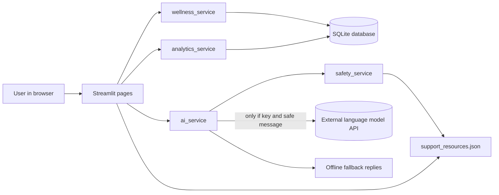
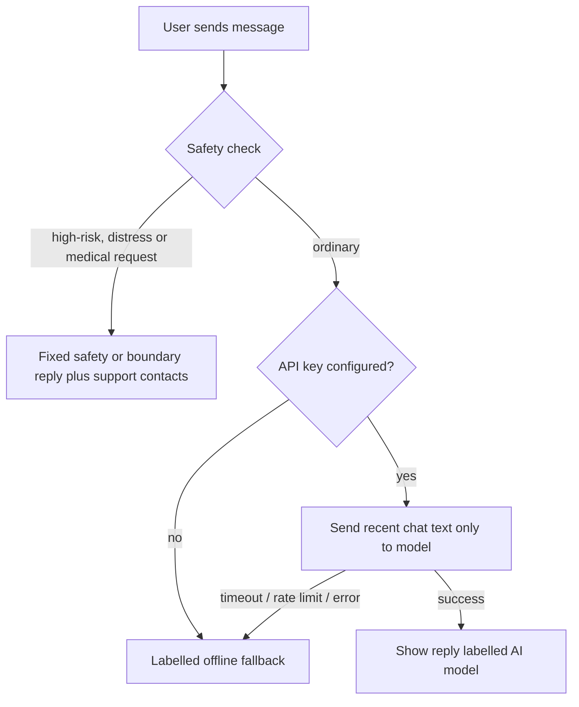

# Concept Notes: MindEase AI

> Status key used in this document: **[Implemented]** = exists in the code and is covered by the tests or smoke checks described in `project_report.md`; **[Proposed]** = future work, not built.
> Replace bracketed placeholders (name, institution) before submission.

## 1. Project Title
**MindEase AI: An AI-Powered Mental Wellness Assistant for Youth** (aligned with UN SDG 3: Good Health and Well-being)

## 2. Abstract
Stress, academic pressure and anxiety are common among young people, yet approachable, low-cost support is not always available when it is needed. MindEase AI is a locally run web application that lets users record daily mood, stress, energy and sleep, reflect on trends, practise short self-care exercises, and chat with a supportive assistant about everyday stress. A dedicated rule-based safety module recognises messages about self-harm, danger or abuse and responds with fixed, compassionate text and pointers to emergency and professional help before any AI model is involved. The chatbot uses a configurable language-model API and falls back to clearly labelled offline replies when no key is available. The application is built with Python, Streamlit, SQLite, pandas and Plotly. It is a general-wellness tool, not a diagnostic or treatment system, and has not been clinically validated or tested with real users.

**Keywords:** mental wellness, SDG 3, chatbot, mood tracking, Streamlit, SQLite, responsible AI, safety.

## 3. Introduction
Mental well-being affects learning, relationships and physical health. Students face exams, career uncertainty, social change and, often, distance from family. Digital tools can lower the barrier to *self-reflection* and *basic coping skills*, but a tool in this area must be honest about what it cannot do. This project explores how a small, understandable software system can offer self-reflection and coping exercises while keeping safety, privacy and honesty at its centre.

## 4. Background and Problem Context
Public-health bodies such as the World Health Organization describe mental health conditions as a significant part of the health burden among adolescents and young adults, and note that many go unrecognised or untreated (see `references.md`, items 1 and 2; read the current version of those sources and add exact figures with citations). In India, the national tele-mental-health service Tele-MANAS and campus counselling cells exist, but awareness, stigma and access vary (reference 4). Students commonly describe stress as something they manage alone between lectures and deadlines. Simple tools that encourage regular self-check-ins can fit into that gap *as a complement to, never a replacement for, professional care*.

## 5. Problem Statement
Lack of mental health support among youth results in stress and anxiety. This project aims to create an AI-powered chatbot, with mood tracking and self-care tools, for mental wellness check-ins and general guidance, together with clear routes to professional and emergency support.

## 6. Problem Justification and Significance
- **Access gap:** professional support can be costly, distant or stigmatised; a private, always-available tool can be a first step.
- **Self-awareness:** regular check-ins make patterns (for example stress rising before exams) visible to the user.
- **Technical significance:** the project demonstrates responsible AI practice (safety layer before the model, honest labelling of fallback replies, privacy by design) in a student-scale system.
- **Caution:** significance here means *potential usefulness for self-reflection*; no health benefit has been measured.

## 7. SDG 3 Alignment and Relevance
SDG 3 aims to ensure healthy lives and promote well-being for all at all ages. Target 3.4 refers to promoting mental health and well-being (reference 3). MindEase AI contributes at the *awareness and self-management* level (early reflection, coping exercises, signposting to help). It does not claim to treat illness or to reduce prevalence of any condition.

## 8. Aim and Measurable Objectives
**Aim:** build a usable, safe and well-documented prototype for youth wellness check-ins and guidance.

| # | Objective (engineering target) | How it is checked |
|---|---|---|
| O1 | Record and manage check-ins (create, view, edit, delete) with validated input | Automated tests on validation boundaries and CRUD **[Implemented]** |
| O2 | App usable with no API key | Fallback tests **[Implemented]** |
| O3 | Safety module flags the defined high-risk phrases and does not flag the defined ordinary phrases | `tests/test_safety.py` (30 cases) **[Implemented]** |
| O4 | Handle empty data in every chart/metric without error | Analytics tests, page smoke runs **[Implemented]** |
| O5 | User can export and delete their own data | CSV test; deletion functions tested **[Implemented]** |
| O6 | Pilot with real students: onboarding and check-in completion, satisfaction | **[Proposed]** (not yet done; targets in `lean_canvas.md`) |

## 9. Scope of the Project
**In scope:** single-user local web app; mood/stress/energy/sleep tracking; six self-care activities; AI chat with fallback; rule-based safety; CSV export; documentation.
**Out of scope:** diagnosis, treatment, clinical risk prediction, accounts/authentication, emergency alerting, cloud hosting, multi-language support, clinician dashboards.

## 10. Intended Users and Stakeholders
- **Primary users:** college students and young adults with everyday stress.
- **Secondary:** student counsellors and wellness cells (possible future partners), faculty supervisors.
- **Stakeholders:** developers, institution, mental-health professionals who should review safety content before any real deployment, and users' families/friends as informal support.

## 11. Existing Approaches and Their Limitations
| Approach | Strength | Limitation |
|---|---|---|
| Campus counselling | Professional, human | Limited slots, stigma, office hours |
| Helplines (e.g. Tele-MANAS) | Human support, free | Need to call; some users hesitate |
| Commercial meditation / mood apps | Polished | Often paid, generic, privacy varies |
| General chatbots | Always available | Not designed for wellbeing safety; may give unsafe advice |
| Paper journals | Private, free | No trends, no guidance |

## 12. Proposed Solution
A local Streamlit app combining (a) structured check-ins with trend charts, (b) guided self-care, (c) a constrained AI chat with a pre-model safety layer and honest fallback, and (d) a support page with an editable, verifiable resource list and data export/delete controls.

## 13. Functional Requirements
FR1 record a check-in (date/time, mood, stress, energy, optional sleep, feelings, notes) · FR2 validate inputs · FR3 edit/delete entries · FR4 supportive reflection after save · FR5 chat with AI or fallback · FR6 safety screening of every chat message · FR7 mood charts with date range · FR8 six self-care activities with completion marking · FR9 dashboard from real data · FR10 support-resources page loaded from a JSON file · FR11 CSV export · FR12 delete data · FR13 optional fictional demo data, clearly flagged. All **[Implemented]**.

## 14. Non-Functional Requirements
- **Safety:** no diagnosis; no false claims about monitoring or alerting. **Privacy:** local storage; chat not saved; notes/moods never sent to AI. **Reliability:** graceful errors, timeouts. **Usability:** calm theme, plain language, empty states, text labels in addition to colour. **Maintainability:** modular services, tests. **Portability:** runs on Windows/macOS/Linux with Python 3.11+. **Performance:** targets are small (single user); no benchmarks were measured.

## 15. Feasibility Analysis
- **Technical:** all components are free, open source and well documented (Streamlit, SQLite, pandas, Plotly). The AI API is optional.
- **Operational:** one command starts the app; no server administration for the demo.
- **Economic:** development cost is student time; running locally is free; AI API calls (if used) are the only variable cost.
- **Schedule:** a 6-week plan is realistic: week 1 requirements and design, 2 database/services, 3 UI, 4 AI and safety, 5 testing, 6 documentation and demo.

## 16. System Architecture

Pages contain only user-interface code. Services contain logic and are testable without Streamlit.

## 17. Data-Flow / Process Diagram (chat message)

Check-in flow: form → validation → parameterised INSERT → reflection text → later read by analytics → charts.

## 18. Detailed Module Descriptions
- `config.py`: constants, environment settings (API key read at call time).
- `database.py`: schema versioning via `PRAGMA user_version`, CRUD with `?` placeholders, CSV export with formula-injection protection.
- `services/wellness_service.py`: input validation (collects all errors), reflection text, activity definitions, study planner, demo data generator.
- `services/analytics_service.py`: DataFrame conversion, distribution, daily averages, summary metrics (7-day vs previous 7-day).
- `services/safety_service.py`: regex categories, priority order, fixed responses, resource loading and verification labels.
- `services/ai_service.py`: model client wrapper with timeout and error classification, message preparation, fallback, orchestration `get_chat_reply`.
- `pages/*`: the seven screens; `ui.py`/`charts.py`: theme and charts.

## 19. Technology Stack and Justification
| Choice | Reason |
|---|---|
| Python | Readable, beginner friendly, strong data libraries |
| Streamlit | Build interactive web UI in pure Python; no separate frontend server |
| SQLite | Zero-setup file database, part of Python's standard library, supports constraints |
| pandas | Concise grouping/averaging for analytics |
| Plotly | Interactive charts that Streamlit renders natively |
| Anthropic SDK (optional) | Supported client with timeouts and typed errors; key via environment variable |
| python-dotenv | Loads `.env` for local development |
| pytest | Simple, readable tests with fixtures for temporary databases |

## 20. Database Schema and Data Flow
`wellness_entries(id PK, entry_time, mood CHECK 1-5, stress CHECK 1-10, energy CHECK 1-10, sleep_hours CHECK 0-24 or NULL, feelings, notes, is_demo CHECK 0/1, created_at, updated_at)`
`activity_completions(id PK, activity_key, completed_at, duration_minutes CHECK >= 0 or NULL, created_at)`
Migrations: `MIGRATIONS` dict applied in order; version stored in `user_version`. Deletion is hard delete (rows are removed). Validation happens twice: in Python for friendly messages and in SQL constraints as a safety net. A single local file means **no per-user isolation**.

## 21. AI Chatbot Design and Fallback
System prompt sets a supportive tone and forbids diagnosis, medication advice, claims of being human, confidentiality promises and dependency-building. Request limits: 20 s timeout (configurable), one SDK retry, 500 max tokens, last 10 turns of chat text. Errors are mapped to codes (no key, SDK missing, rate limit, timeout, connection, auth, invalid response, unknown); only the exception class name is logged. When any of these happen the user sees a keyword-based reply labelled *"Offline fallback reply (not generated by an AI model)"* plus the reason. **Prompt instructions are not guarantees**: a model can still produce inappropriate text, which is why the safety layer is separate and why real deployment needs human review.

## 22. Mood-Tracking and Analytics Methodology
Self-reported mood (1-5), stress and energy (1-10) are stored as given. Analytics: counts per mood level; per-day means; "recent" = last 7 days including today vs "previous" = the 7 days before; change = recent mean minus previous mean, shown only when both windows have data. These are descriptive statistics of self-reports, not clinical measures, and small samples are noisy.

## 23. Safety, Privacy, Ethical Considerations and Limitations
- **Safety flow:** categories checked in priority order (self-harm, immediate danger, abuse, severe distress, medical request). High-risk messages receive calm text, encouragement to contact local emergency services and a trusted person, and the contact list; the app states it has *not* alerted anyone and is not monitored. These messages never reach the model.
- **Limits:** pattern matching misses indirect, misspelled or non-English language and can over-trigger; it is not a validated risk assessment. No clinical risk model is built.
- **Privacy:** local SQLite; chat not stored; notes/moods never sent externally; no secrets in code; no user text in logs; CSV export and delete controls.
- **Ethics:** no manipulation or dependency-building; demo data labelled fictional; support numbers shown as unverified until checked.
- **Not done:** encryption at rest, authentication, consent flows, clinician review, bias evaluation, support for Indian languages.

## 24. Testing and Evaluation Methodology
Unit tests (pytest style) for database, validation boundaries, analytics on empty/non-empty data, CSV export, safety true/false-positive phrases, AI service with fake clients (missing key, each error class, empty reply, secret redaction, no model call for high-risk text). Page smoke execution against a stub of Streamlit. Manual UI checklist in `README.md`. **Evaluation with real users is proposed, not performed.** Actual results are in `project_report.md`.

## 25. Expected Outcomes
Realistic outcomes of the current build: a working prototype that demonstrates the full flow, is explainable in a viva, and shows responsible-AI design. Outcomes such as reduced stress for users are *hypotheses to be tested*, not results.

## 26. Innovation and Differentiation
Safety layer independent of the model and functional offline; honest labelling of fallback replies; privacy rule that moods/notes never go to the AI provider; editable and verification-aware support-resource file; clear demo-data flagging; simple enough for students to understand fully.

## 27. Future Scope **[Proposed]**
Authentication and per-user storage with encryption; consent and privacy notice; verified resource updates with automated link checks; regional-language support; improved safety classifier evaluated with clinicians on consented data; campus-counsellor handoff; pilot study with ethics approval; accessibility audit; optional opt-in chat history.

## 28. Conclusion
MindEase AI shows that a small, understandable system can combine self-reflection tools, a constrained AI assistant and an independent safety layer while being honest about limits. Its value for real users remains to be established through ethical, supervised testing.

## 29. References and Sources
See `references.md`. Verify each URL and add exact statistics from the current versions before submission.
